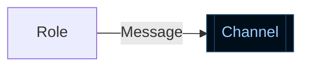

# Explain Architecture

Make the reader see where to start, what the main actor wants, and how the system
fulfills that objective. Choose nodes for their role in the behavior being
explained. Source files, classes, and crates are evidence or annotations unless
the user specifically asks for that structural view.

This skill governs display. Detail mode does not introduce review judgments,
findings, verdicts, or proposed fixes. When a broader task includes a review,
this skill governs its diagrams and supporting details only.

## Establish the story and evidence

Identify the requested behavior, its scope, the primary actor, and the important
secondary actor. Derive prominence from the system's purpose and the user's
question, not source-code size, dependency count, or startup chronology.

Trace the relevant entry points, I/O operations, task creation, dispatch,
channels, and shared state in the available code. Keep implemented behavior,
documented contracts, mocks, and external or unverified behavior distinguishable.
Do not invent a network protocol, thread assignment, or service implementation
to complete a diagram. State whether the view describes current source, a
release, or observed runtime behavior when that distinction matters.

## Choose the diagram form

Diagram form and detail level are separate choices:

- Use an architecture diagram to show participants, responsibilities, and
  connections.
- Use a sequence diagram to show what happens in order, including conditions,
  waits, responses, callbacks, and execution transfers relevant to the scope.
  Distinguish synchronous calls, queued messages, events, and shared-state
  access through labels or notation. Do not infer ordering from a connection.
- Either form can use any of the three levels below. Follow an explicitly
  requested form; otherwise choose the form that answers the question. Use both
  only when they explain different things. A sequence lifeline can represent a
  logical actor or repeated role; it does not imply a dedicated OS thread.

## Choose the level

Use three levels of explanation. A broad architecture request can progress
through all three; a focused request may need only one. Split dense levels by
interaction or subsystem instead of merging everything into a single diagram.

Default mode and detail mode are independent of these abstraction levels. Use
default mode unless the user requests detail mode or its specific additions.
A request for low-level architecture alone does not enable detail mode.
Detail mode adds only:

- Channel capacities on the diagram, with units or `unbounded` / `unknown`.
  Capacity is not current occupancy.
- Appendix tables describing fields of data crossing file, IPC, network, ABI,
  and other boundaries, as described below.

Omit those additions in default mode. Show multiplicity in both modes wherever
the selected level includes repeated actors or tasks.

### High: conceptual overview

Answer: who are the main characters, and what do they accomplish together?

- Nodes represent concepts meaningful in the project. One logical actor may
  span multiple processes or machines; do not force it into a process boundary.
- Show the central objective and relationships. Leave implementation machinery
  for the next levels unless it is itself central to the requested concept.

### Medium: observable interactions

Answer: what crosses a boundary to produce the behavior?

- Show all relevant observable boundaries within the requested scope: network
  I/O such as HTTP requests, IPC, file reads/writes, UI input/output, DLL or
  module loading, and process spawning. Include only categories actually present.
- Identify the relevant processes, machines, users, files, and external
  endpoints. Expand a conceptual actor into its concrete participants as needed.
  A DLL runs in the process that loads it, regardless of which application
  distributes its file.
- Label edges with the operation or data and its direction. Distinguish calls,
  requests, responses, events, and launches where the distinction matters.
- In architecture diagrams, represent a single bidirectional connection with
  one bidirectional edge by default. Label the transport and messages flowing
  each way. Use separate directional edges only when they clarify distinct
  behavior, and explicitly identify any shared connection. Introduce a transport
  node when its own properties need explanation. Never imply separate physical
  connections merely because requests and responses travel in opposite directions.
  Sequence diagrams retain separate request/response arrows to show events over time.
- Collapse WMI and similar OS-service interactions into API calls by default:
  system components usually sit outside the project. Expand them when requested
  or central to the behavior. This does not hide file, network, or IPC boundaries
  merely because the program accesses them through an OS API.
- Keep supporting I/O visible but subordinate. Do not remove requested
  boundaries simply to make the protagonists stand out.

### Low: execution and communication

Answer: where does work run, and how do execution contexts communicate?

- Show relevant threads and coroutine/async-task boundaries. Place tasks within
  their actual thread, event loop, executor, or worker pool. Distinguish blocking
  workers and dedicated threads. Do not imply one thread per coroutine or assign
  a migrating task to a fixed worker. Mark unknown placement explicitly.
- Show multiplicity when a thread or task role has more than one instance, such
  as `Worker threads x2` or `Reader tasks x active connections`. Aggregate roles
  with identical behavior; separate instances when their behavior differs.
  Distinguish fixed counts, dynamic counts, and configured maximums. Do not
  present a source-derived limit as an observed current count.
- Show channels/queues with producers, consumers, direction, and carried data.
  Show shared state separately, naming its readers/writers and synchronization
  where relevant. Do not depict task-owned state as shared across threads.
- Include callback delivery context, waits, ordering, and
  backpressure when they explain the requested behavior; avoid a catalog of
  incidental locks and implementation constants. Show established wait/reject/drop
  behavior where relevant; do not guess from the queue name.
- Retain medium-level endpoints and boundaries when the requested scope includes
  them, so the reader can follow work from execution context to observable I/O.

## Reveal boundary data progressively

Give important interactions their actual message or type name and purpose.
For medium-level boundaries, distinguish the wire, file, or ABI representation
from an in-memory type when they differ. At low level, identify channel element
types and shared-state records, including which actors read or write them.

Keep the main diagram concise. In detail mode, add appendix tables for data
structures crossing the shown boundaries. Describe fields with readable,
high-level names and meanings rather than source identifiers. If a structure
has many fields, include only those important to the requested behavior. Key
each table to its diagram interaction and link to the source for exact field
names, types, and complete definitions. Do not put field inventories on the
diagram or include these appendix tables by default.

Make the complete definition reachable through a source link or requested
expansion. Link important actors and interactions to their implementations,
including producer and consumer code when useful. Select details for the user's
scope and preserve the main reading path as more information is revealed.

## Compose around the protagonists

Each diagram needs a clear entry point and visual hierarchy, even without color.

- Give the primary actor the natural starting position for the chosen reading
  direction, a prominent footprint, and enough surrounding space. Place the
  secondary actor next along the main interaction axis.
- Make the main path easy to follow. Place supporting actors and secondary
  paths off that axis; keep response paths from obscuring the initiating flow.
  Do not let an upstream file, launcher, or infrastructure node accidentally
  become the starting point just because its edge points into the protagonist.
- Use position, size, grouping, spacing, and appropriate shape to establish
  prominence. Color may supplement this hierarchy but must not carry it alone.
  Preserve shape semantics for processes, resources, queues, and shared data.
  A label saying "main actor" or "start here" is not a substitute for composition.
- Preserve names and conceptual continuity while zooming in. A lower layer can
  have a new focal actor, but make clear which higher-level actor it expands.
- If a rendered preview is available, check the actual reading order, crossings,
  and legibility, not just the diagram source. Split or simplify a dense view
  when automatic placement obscures the protagonists.

For example, a game SDK that lets a game use host features starts with the game
as the primary actor and the host as the secondary actor, connected by the
feature request/result path. DLL loading and relaunch are supporting paths. A
zoom into game execution starts with the calling thread and follows its work
through queues and workers. A question specifically about launching the game
can instead make the launcher the protagonist.

## Mermaid presentation

Use Mermaid for architecture and sequence diagrams, with supporting Markdown
and source links. Split dense views into focused diagrams.

In architecture diagrams, keep role nodes in the renderer's default style.
Use the square queue shape for channel nodes and retain directional arrows.
Apply the following direct style to each channel node:

Reserve cylinders for storage, not communication channels. Do not rely on shape
to determine color or use `!important`. These explicit channel colors need not
exactly match message labels, whose appearance is controlled by the renderer.

## Deliver and check

Introduce the purpose and scope briefly, then show the selected layers. Keep
explanations focused on consequences the diagrams do not already make clear.
Provide a few precise source references and disclose material evidence gaps.
Architecture explanation alone does not require changing code or running it.

Before finishing, check that the reader can identify the protagonist and main
path without relying on color; that each diagram has a coherent abstraction
level and suitable form; that scoped I/O boundaries are covered; and that task
placement, counts, and shared-state ownership agree with the evidence. In detail
mode, also check channel capacities and appendix fields against the evidence.
Check that boundary details remain discoverable through source links without
overwhelming the main diagram.
