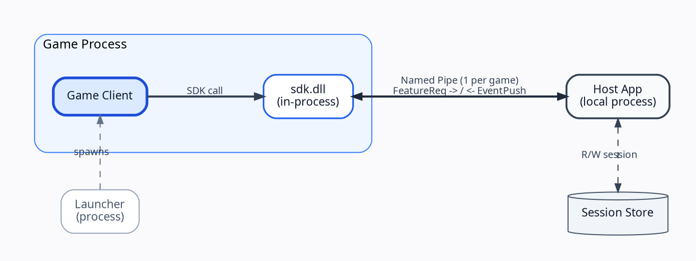
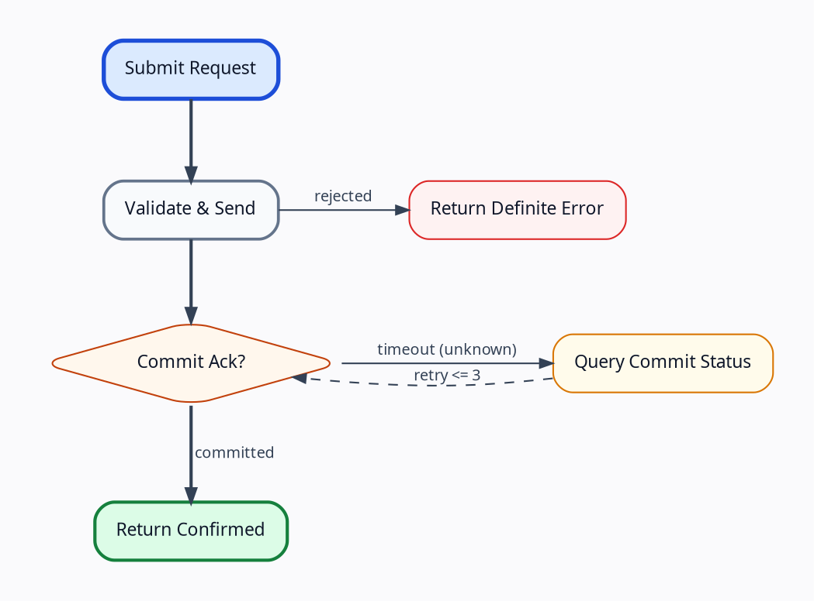

# Explain Architecture

Make the reader immediately see **where to start**, **what the primary actor wants**, and **how the system fulfills that objective**. Choose nodes for their behavioral role, resource identity, or execution step—not source files, classes, or crates, which serve only as evidence links unless the user explicitly asks for a structural map.

This skill governs **display only**. Even in detail mode, never introduce code-review judgments, bug findings, verdicts, or proposed fixes. Inside a broader review task, this skill governs only its diagrams and supporting factual details.

## 1. Establish Story and Evidence

- **Derive prominence from purpose**: Identify the requested behavior, scope, **primary actor (protagonist)**, and **main secondary actor** from the system's goal and the user's question—never from code size, dependency count, or startup chronology.
- **Ground every element in code**: Trace entry points, I/O calls, task creation/dispatch, channels, and shared state. Keep **implemented behavior**, **documented contracts**, **mocks**, and **external/unverified behavior** clearly distinguishable.
- **Never invent machinery**: Do not fabricate network protocols, thread assignments, queue drop policies, rollback, or atomicity to make a diagram look complete. State whether the view reflects **current source**, a **shipped release**, or **observed runtime behavior** whenever they could differ.

## 2. Select Form, Level, Mode, and Nesting

Diagram **Form**, abstraction **Level**, detail **Mode**, and **Nesting (`L0 → L1`)** are orthogonal choices.

### 2.1 Architecture & Flow Representation

Honor any explicitly requested tool or format (e.g., pure Mermaid, Draw.io, PlantUML, ASCII, schema, or class diagram). Otherwise use **Graphviz DOT** (`rankdir=LR`) for **Architecture** (participants, responsibilities, boundaries, topology) and pick the **lightest Flow representation** that matches what makes the flow non-obvious—**never redraw the same linear happy path across multiple flow forms**:

| Flow Shape | Default Representation | When to Use | Guardrail |
| :--- | :--- | :--- | :--- |
| **Simple cross-role path** *(≤ 6–8 sequential hops)* | **Step markers (`①`–`⑥`) on Architecture + Plain-Text Numbered List** | Reader wants end-to-end request/data path with minimal async interleaving | Do not add a redundant Sequence or Flowchart repeating `① → ⑥` |
| **Phased lifecycle or linear procedure** | **Plain-Text Structured List** *(grouped by phase)* | Sequential setup/teardown or stage transitions without tricky races or branches | Do not turn linear prose into a vertical chain of flowchart boxes |
| **Multi-party data exchange & async handshakes** | **Sequence Diagram** (`Mermaid sequenceDiagram`) | Core complexity is **who exchanges what payload/callback with whom and when** across ≥ 3 roles | Align lifelines with Architecture roles; keep heavy retry/branch trees out of `alt/loop` blocks |
| **Branching, guards, retry loops & error exits** | **Flowchart** (`Graphviz DOT` `rankdir=TB`) | Core complexity is **decisions, loops, timeouts, and recovery** inside an operation or protocol | Focus on decision/loop logic; do not duplicate cross-role payload inventories |

Never infer temporal ordering from an unnumbered static architecture connection alone.

### 2.2 Abstraction Levels & Boundary Precedence

Apply this **3-tier precedence** to decide which boundaries to expose vs. merge:

1. **Explicit actor/merge filter wins first**: When the user specifies which roles or planes to focus on or fold (e.g., *"focus on networking using game, host, and server"*), honor that exact grouping and merge everything else while preserving the active level's precision on the remaining edges.
2. **Explicit level (`High` / `Medium` / `Low`) without a merge filter is honored faithfully**: Do **not** silently hide real boundaries of the requested level along the execution path of the requested feature (still omit unrelated features that never run in that flow). When full boundary fidelity exceeds a comfortable single graph, preserve readability via **`L0 → L1` nesting and splitting** (§2.4) rather than dropping boundaries or cramming one flat canvas.
3. **Unspecified level defaults to Task-Focused Adaptive Merging**: Human attention is limited—keep boundaries central to the user's question at concrete (`Medium`/`Low`) precision, and **merge incidental/supporting boundaries** (forwarding DLLs, internal helper process splits, routine config stores) into their owning behavioral role (`5–9` roles on the overview). Offer deeper `Medium`/`Low` zoom-ins only when hidden boundaries or concurrency materially affect the answer.

| Level | Core Question | Required Visibility & Grouping Rules |
| :--- | :--- | :--- |
| **High** *(Conceptual)* | Who are the main characters, and what do they accomplish together? | Domain concepts and central objective. One logical actor may span processes or machines. Flowchart nodes represent business stages and key outcomes. Omit low-level machinery unless directly asked. |
| **Medium** *(Observable I/O)* | What crosses a boundary to produce the behavior? | Concrete processes, machines, users, files, devices/drivers, and external endpoints. Show every real boundary along the scoped flow: network I/O (HTTP/RPC/WS/TCP/UDP/QUIC/raw sockets, **listener/destination ports**, and **listener bind scope** such as `127.0.0.1` loopback vs. `0.0.0.0`/LAN/WAN), DB/cache, IPC, file R/W, UI I/O, DLL/module loading, process spawning, and **project-relevant device/kernel boundaries** (virtual NICs like TUN/TAP/Wintun, kernel drivers `.sys`/`.ko`, packet filters like WFP/NDIS/eBPF/Netfilter, `DeviceIoControl`/`ioctl` on `\\.\*` or `/dev/*`, kernel-user ring buffers, and directly accessed hardware/virtual devices). Keep supporting/fallback I/O visible but subordinate. Do **not** hide multiple external calls inside one generic flowchart step. |
| **Low** *(Execution & Sync)* | Where does work run, and how do execution contexts communicate? | Threads, event loops, executors, and worker pools (`subgraph cluster_*`); distinguish blocking workers vs. dedicated threads. Expose task handoffs, waits, connection ownership, channels (producers, consumers, element types), and shared state (readers, writers, locks/atomics) plus verified callback/ordering/backpressure behavior. Retain scoped Medium external endpoints so work traces through to observable I/O. |

### 2.3 Default Mode vs. Detail Mode

Use **Default mode** unless the user explicitly asks for **Detail mode** or its specific additions. **Requesting a Low-level view alone does not enable Detail mode.**

- **Both modes** must show **multiplicity** whenever repeated actors, connections, or tasks exist (e.g., `Worker threads x2`, `Reader tasks x active connections`). Distinguish **fixed counts**, **dynamic counts**, and **configured maximums**—never present a source limit as an observed runtime count.
- **Detail mode adds only** (scoped strictly to the boundaries visible in the presented diagrams or dedicated `L1` queue zoom-ins—never re-dump folded boundaries in the appendix):
  1. **Channel capacities** on the diagram with units or `unbounded` / `unknown` (capacity ≠ current occupancy).
  2. **Boundary data appendix tables** keyed to shown diagram edges (file, IPC, network, ABI, `ioctl`/device/ring-buffer), listing only behavior-relevant fields with readable high-level names/meanings and source links to exact definitions. Never dump field inventories onto diagram nodes.

### 2.4 Progressive Nesting & Splitting (`L0 → L1`)

- **Anchor with `L0` first**: Always open complex systems with a clean `L0` overview (`5–9` top-level roles) + end-to-end happy-path flow so the reader never has to stitch peer sub-diagrams together blindly. Stop at `L0` whenever the system fits cleanly (`≤ 12` nodes).
- **Split & nest `L1` zoom-ins (`≤ 12` nodes each)** when an explicit `Medium`/`Low` request or subsystem complexity exceeds one readable diagram, always naming the `L0` role or step being expanded:
  - **Nested Architecture (`Zoom-in: Inside <L0 Role>`)**: Expand one composite actor's internal modules/processes/queues while collapsing external `L0` peers to single boundary stubs.
  - **Nested / Split Flow (`Zoom-in: <Phase or Decision Logic>`)**: Keep the end-to-end happy path clean (numbered list or high-level Sequence diagram), and extract dense sub-phases or branch/retry/timeout state machines into focused `L1` Flowcharts or sub-sequences.

## 3. Non-Negotiable Modeling Laws

1. **Aggregation & P2P Symmetry**: Aggregate repeated actors **only** when their count is incidental/variable **and** their roles and relationships are fully interchangeable. Keep opposite endpoints and distinct ownership contexts separate even when running identical binaries. For one P2P connection, draw the **initiator** and **receiver** and each side's **local client + game/app** separately—never imply a shared local client, connection, or state that does not exist.
2. **In-Process Modules, Kernel/Device & OS Boundaries**: A user-mode DLL, shared library, or plugin runs **inside the process that loads it** (`cluster_*`), regardless of which application distributes its file on disk. By contrast, **kernel drivers (`.sys`/`.ko`), virtual NICs (TUN/TAP/Wintun), packet hooks (WFP/NDIS/eBPF), and device nodes (`\\.\*`, `/dev/*`) sit across the User ↔ Kernel / OS-stack boundary**—never place them inside a user-mode process `cluster_*`, even when paired with an in-process helper DLL (e.g., `wintun.dll` in-process vs. Wintun adapter/driver in kernel). Keep project-installed, opened, or traffic-intercepting drivers/devices explicitly visible—separating **control plane** (`ioctl`/driver load/route & filter rules) from **data plane** (packet capture, ring-buffer/`tun` I/O) where both exist—while collapsing generic OS services (like WMI) and standard OS filesystem/physical-NIC drivers behind ordinary file/socket calls unless central or requested.
3. **Ports, Connections & Sessions**: Surface **listener/destination ports**, transport protocols (TCP vs. UDP), and **listener bind scopes** (`127.0.0.1` loopback vs. `0.0.0.0`/external, or a listener binding `:0` and advertising its dynamic port) when a process exposes or connects to distinct service endpoints. **Omit ordinary outbound sender source ports and never draw standalone client-socket nodes**—surface a sender's local bind **only** when architecturally significant (e.g., a symmetric UDP/STUN/P2P port that also receives peer traffic, or explicit NIC binding like `SO_BINDTODEVICE`/`IP_UNICAST_IF` to bypass a virtual NIC). Remember **endpoint/port ≠ connection**: state whether interactions multiplex over **one shared connection** or open **separate connections** (even to the same `host:port`, e.g., `1 WebSocket per room`), and show setup/closure when relevant. In architecture diagrams, draw a **single bidirectional connection as one `dir=both` edge** labeled with transport/destination-port + messages each way (`Req -> / <- Event`), splitting only to clarify distinct behavior while noting the shared connection.
4. **Concurrency & State Accuracy**: Never imply one OS thread per coroutine/async task, and never pin a migrating pool task to one fixed worker; mark unverified placement as `unknown`. Draw task-owned local state inside the task—never as cross-thread shared state. Show wait/reject/drop backpressure only when verified in code; never guess from queue names.
5. **Workflow Branch, Retry & Unknown-Commit Rigor**: Give each action node one coherent purpose. Put explicit conditions in diamond nodes and label outgoing branches. Route retry edges back to the **exact step repeated** with the implemented attempt or deadline limit. Distinguish **definite rejection** from an **unknown commit result** (timeout/disconnect after send) and show actual recovery; never invent rollback or atomicity. Mark async dispatch, cleanup, and compensation with their true execution context and trigger conditions (do not imply background tasks finish before the response or that cleanup runs only on success unless proven). Split complex subprocesses while preserving parent stage name, entry, exits, and return position.
6. **Progressive Boundary Data**: Label important edges with real message/type names and purpose. At Medium level, note when wire/file/ABI encoding differs from in-memory structs. Link key actors, producers, consumers, and boundary types to source files.

## 4. Protagonist Composition & Engine Rules

### 4.1 Compose Around the Protagonists

- **Anchor the protagonist first**: Place the primary actor at the natural reading origin (`rank 0`: far-left in `LR`, top in `TB`) with the strongest border weight, followed immediately by the main secondary actor along a straight primary axis. Do **not** rely on `"start here"` text labels to rescue poor layout.
- **Keep upstream helpers subordinate**: Never let a config file, launcher, or DLL loader push the protagonist out of `rank 0` merely because its edge points into the protagonist.
  - *Example*: For a game SDK exposing host features, **Game** is primary and **Host** is secondary along the horizontal request/result spine; DLL loading and launcher relaunch enter perpendicularly as supporting paths. Only a question specifically about launching promotes **Launcher** to protagonist.

### 4.2 Graphviz DOT Mechanics (Architecture & Flowcharts)

Combine **rank-driven in/out separation** with **shortest-path boundary clipping** so edges stay short, untangled, and well-spaced:

- **Omit compass ports (`:n/:s/:e/:w`) by default (Shortest-Path Clipping)**:
  - Before `dot` runs, final 2D node positions are unknown—hardcoding `:e -> :w` or `:s -> :n` causes **180° wrap-around hooks** (when a target lands above or behind the source) and **single-point pinch knots** (forcing 4+ outgoing splines onto one center pixel of `:e`).
  - Leave edges **unported** (`A -> B`) so `dot` clips each spline to the **nearest facing border** and spreads multiple outgoing edges evenly along the node perimeter. Never attach compass ports to hub nodes (degree ≥ 3), cross-cluster edges, or diagonal/backward edges.
- **Separate In vs. Out via Rank Progression & Perpendicular Docking (not port syntax)**:
  - Forward rank order (`rank(upstream) < rank(actor) < rank(downstream)`) naturally brings inputs into the upstream side (`left` in `LR`, `top` in `TB`) and sends outputs out the downstream side.
  - Put `group="main"` and `weight=10, penwidth=2.0` on the **true synchronous primary spine** (not secondary background timers) so the core path stays straight and short.
  - Dock **at most one** pure local helper/lock beside an actor using `{ rank=same; Helper; Actor }` (with `dir=both` for acquire/release or R/W, unported) for a 1-hop perpendicular link; stacking two `rank=same` helpers on one actor forces skip-over arcs. Place helpers that also call downstream services at `rank(Actor) + 1` along their forward path.
- **Keep DAG edges constrained so `dot` minimizes crossings & guard `rank 0`**:
  - Weight primary synchronous calls (`weight=6..10`) so shared sinks (e.g., Redis/DB) sit near their call barycenter (1 hop from heavy callers). Keep forward async/cross-cluster edges **constrained** (default `constraint=true`, unported) so `dot`'s crossing-minimizer (`mincross`) vertically aligns producers with their target clusters instead of crossing lines across the canvas.
  - Because `constraint=false` both skips rank assignment (snapping zero-in-degree targets to `rank 0`) **and** bypasses crossing minimization, use `constraint=false` **only** on **cycle-creating retry/callback back-edges** and **rank-0 upstream spawners** (`Launcher -> Game [constraint=false]`). **Never** write `rank=same` across different `subgraph cluster_*` scopes.
- **Control hub fan-out, label clearance & container breathing room**:
  - Keep edge labels concise (≤ 22 chars/line, max 2 short lines, space-padded `" label "`) with `ranksep=1.0`, `nodesep=0.50`, and `edge [arrowsize=0.8]`. Never cram `if` prose or multi-command scripts onto architecture edges. Short `①`–`⑥` step prefixes on an `L0` architecture diagram are encouraged when paired with a plain-text step list; switch to a `sequenceDiagram` when back-and-forth across the same edges would clutter labels. If one hub radiates > 6 edges, split cohesive sub-stages or collapse request/reply pairs into `dir=both`.
  - **Never use `splines=ortho`** (misplaces edge labels); use `splines=true` or `splines=polyline`. Name visible containers `subgraph cluster_<id>` with `labeljust="l"; labelloc="t"; margin=18; fontsize=12`. Always set `bgcolor="#FAFAFC"` and a CJK-safe sans-serif `fontname`; use bold rounded boxes for protagonists, rounded boxes for roles/actions, `shape=parallelogram` for channels/queues, `shape=cylinder` for storage/shared state, and `shape=diamond` for decisions.

**Pattern A — Medium Architecture (`rankdir=LR`, unported shortest-path + rank-driven in/out separation)**:



**Pattern B — Workflow Flowchart (`rankdir=TB`, straight spine + perpendicular side exits + bounded retry)**:



### 4.3 Inline Rendering, Artifacts & Mermaid Sequence Rules

- **Render diagrams inline as visible images and omit DOT source from chat**: Save `.dot` and compiled image files in the session artifact folder or an OS temp subfolder (never inside an untracked repository tree unless the user asks to save project docs), and **never paste raw `.dot` source code into chat unless explicitly asked**. When `dot` is installed, compile every DOT graph (`dot -Tsvg` / `dot -Tpng`) to verify zero syntax errors and **always render the diagram inline so the user views the image directly in the conversation—never output a bare file link in place of the diagram**. Choose an inline image embedding or native diagram block that renders visually under the active host's chat/Markdown constraints. If `dot` is unavailable, mention installing Graphviz (`scoop install graphviz` / `winget install Graphviz.Graphviz`) in one short note and use a faithful inline-rendered fallback without dumping raw DOT code.
- **Mermaid `sequenceDiagram` rules**: Render sequence diagrams inline in ```` ```mermaid ```` blocks. Declare participants in left-to-right interaction order starting with the protagonist. Distinguish sync calls (`->>`), async/queued messages (`-)`), responses (`-->>`), and activation/waits. **Never put raw `;` in sequence messages or notes** (Mermaid parses `;` as a statement break—use `,`, `and`, or `#59;`).
- **No visual-inspection loops**: Checking `dot` exit status validates syntax; do **not** open browsers, capture screenshots, or iterate on rendered pixels.

## 5. Deliver and Verify

1. **Deliver concisely**: State the scope and provenance in 1–2 sentences, present the inline-rendered diagrams and chosen flow breakdown, explain **only non-obvious consequences and trade-offs** (do not narrate arrows the diagram already shows), link key implementations in source, and disclose any material evidence gaps. Architecture explanation alone requires neither modifying nor running project code.
2. **Pre-finish semantic & syntax check**:
   - Every diagram is **rendered inline as a visible image/diagram** (never a bare file link or raw `.dot` dump); DOT compiles cleanly with no `splines=ortho`, no hardcoded `:n/:s/:e/:w` ports on hubs/cross-cluster/backward edges, at most one `rank=same` helper per actor, no cross-cluster `rank=same`, and no unintended rank-0 orphan nodes; Mermaid sequences contain no raw `;`.
   - Boundary precedence is respected: explicit actor/merge filters win; explicit `High`/`Medium`/`Low` levels preserve all real boundaries along the scoped flow via `L0 → L1` nesting rather than silent hiding; unspecified levels merge off-task boundaries into `5–9` clear roles.
   - Flow form matches complexity (`①–⑥` + list, plain-text list, Sequence, or Flowchart) without duplicating the same linear happy path across multiple diagrams; protagonist sits at `rank 0` with bold visual weight and a straight `group="main"`, `weight=10` spine.
   - Channels use parallelograms, storage uses cylinders, and single bidirectional transports use one `dir=both` edge with explicit connection multiplicity.
   - User-mode DLLs sit inside loader processes while kernel drivers/virtual NICs sit outside across the User ↔ Kernel boundary (with control vs. data plane distinguished); listener/destination ports and bind scopes are identified (without cluttering ordinary senders with client source ports or socket nodes); P2P peers remain separate; coroutines are not drawn as OS threads; flowcharts distinguish definite rejection from unknown commit and route retries to the exact repeated step with real limits.
   - Detail-mode capacities and appendix field tables appear **if and only if** requested, scoped strictly to visible boundaries, with working source links.
