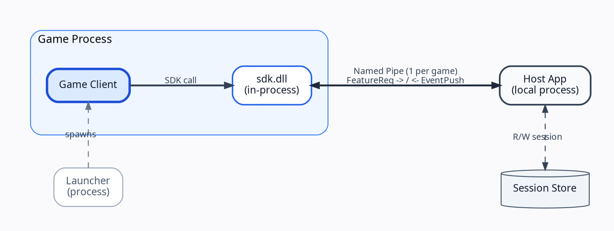
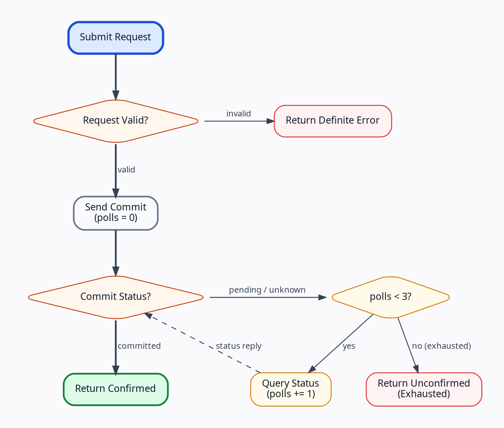

# Explain Architecture

Make the reader immediately see **where to start**, **what the primary actor wants**, and **how the system fulfills that objective**. Choose nodes for their behavioral role, resource identity, or execution step—not source files, classes, or crates, which serve only as evidence links unless the user explicitly asks for a structural map.

This skill governs **display only**. Even in detail mode, never introduce code-review judgments, bug findings, verdicts, or proposed fixes. Inside a broader review task, this skill governs only its diagrams and supporting factual details.

## 1. Establish Story and Evidence

- **Derive prominence from purpose**: Identify the requested behavior, scope, **primary actor (protagonist)**, and **main secondary actor** from the system's goal and the user's question—never from code size, dependency count, or startup chronology.
- **Ground every element in code**: Trace entry points, I/O calls, task creation/dispatch, channels, and shared state. Keep **implemented behavior**, **documented contracts**, **mocks**, and **external/unverified behavior** clearly distinguishable.
- **Never invent machinery**: Do not fabricate network protocols, thread assignments, queue drop policies, rollback, or atomicity to make a diagram look complete. State whether the view reflects **current source**, a **shipped release**, or **observed runtime behavior** whenever they could differ.

## 2. Select Form, Level, Mode, and Nesting

Diagram **Form**, abstraction **Level**, detail **Mode**, and **Nesting (`L0 → L1`)** are orthogonal choices.

### 2.1 Architecture & Flow Representation

Honor any explicitly requested tool or format (e.g., pure Mermaid, Draw.io, PlantUML, ASCII, schema, or class diagram). Otherwise use **Graphviz DOT** (`rankdir=LR`) for **Architecture** (participants, responsibilities, boundaries, topology) and pick the **lightest Flow representation** that matches what makes the flow non-obvious—**never redraw the same linear happy path across multiple flow forms**:

| Flow Shape | Default Representation | When to Use | Guardrail |
| :--- | :--- | :--- | :--- |
| **Simple cross-role path** | **Step markers (`①`–`⑥`) on Architecture + Plain-Text Numbered List** | **All** hold: each Architecture edge carries **≤ 1–2 sequential hops** (no repeated back-and-forth ping-pong on the same edge), no critical async interleaving, ordering barrier, or asymmetric multi-party handshake, and the path is a clean forward/request-reply chain (~≤ 6–8 steps) | Do not add a redundant Sequence or Flowchart repeating `① → ⑥` |
| **Phased lifecycle or linear procedure** | **Plain-Text Structured List** *(grouped by phase)* | Sequential setup/teardown or stage transitions without tricky races or branches | Do not turn linear prose into a vertical chain of flowchart boxes |
| **Multi-party data exchange & async handshakes** | **Sequence Diagram** (`Mermaid sequenceDiagram`) | **Any** holds: the same transport edge is reused across multiple ordered round-trips (auth, handshake, polling, commit/ack), ≥ 3 roles have ordering barriers, concurrent interleaving, callbacks, or asymmetric startup orders, or payload evolution across roles is the core question | When a companion Architecture diagram is present, keep it **unnumbered** (pure topology) and map every lifeline **1:1** to a role in the corresponding Architecture view (including `L1`-expanded roles, or the active subset in a phased `L1` sub-sequence)—never merge roles to save width; keep heavy retry/branch trees out of `alt/loop` blocks |
| **Branching, guards, retry loops & error exits** | **Flowchart** (`Graphviz DOT` `rankdir=TB`) | Core complexity is **decisions, loops, timeouts, and recovery** inside an operation or protocol | Focus on decision/loop logic; do not duplicate cross-role payload inventories |

Never infer temporal ordering from an unnumbered static architecture connection alone.

### 2.2 Abstraction Levels & Boundary Precedence

Apply this **2-tier precedence** to decide which boundaries belong at leaf fidelity:

1. **Explicit actor/merge filter wins first**: When the user specifies which roles or planes to focus on or fold (e.g., *"focus on networking using game, host, and server"*), honor that exact grouping and merge everything else while preserving the active level's precision on the remaining edges.
2. **Abstraction Level governs leaf fidelity across the deliverable (not cramming `L0`)**: Unspecified level defaults to **High (Default)**. Explicit **Medium** or **Low** must faithfully expose every real boundary of that level along the scoped execution path across its leaf views (still omitting unrelated features that never run in that flow), routing complexity through **`L0 → L1` splitting** (§2.4) rather than dropping boundaries.

| Level | Core Question | Boundary Unit & Visibility Rules |
| :--- | :--- | :--- |
| **High** *(Default — Conceptual)* | What are the **core design concepts and behavioral roles**, and how do they fulfill the objective? | A **conceptual coarsening of Medium** organized around the project's high-level design concepts and task focus. Keeps first-class conceptual roles (including major in-process subsystems from Medium) separate while folding incidental process splits, helper/wrapper processes, forwarding layers, and routine stores into their owning concept. Surface concrete I/O details (ports, bind scopes, kernel/device splits) only when central to the question or necessary to prevent a misleading interpretation; label edge transport (`in-process call` vs. `HTTP`/`IPC`) when process vs. in-process semantics could be misread. |
| **Medium** *(Observable I/O & Module Boundaries)* | What **observable runtime and module boundaries** produce the behavior? | Concrete processes, machines, users, files, devices/drivers, external endpoints, and **distinct in-process subsystems/modules** inside `cluster_<process>` (components with independent responsibilities/lifecycles, disjoint external I/O domains, or swappable in-process/out-of-process boundaries—keeping their direct in-process relationship explicit, and never splitting down to individual source files or classes). Show every real boundary along the scoped flow: network I/O (HTTP/RPC/WS/TCP/UDP/QUIC/raw sockets, **listener/destination ports**, and **listener bind scope** such as `127.0.0.1` loopback vs. `0.0.0.0` wildcard IPv4 / all interfaces—reporting actual LAN/WAN reachability separately only when evidenced), DB/cache, IPC, file R/W, UI I/O, DLL/module loading, process spawning, and **project-relevant device/kernel boundaries** (virtual NICs like TUN/TAP/Wintun, kernel drivers `.sys`/`.ko`, packet filters like WFP/NDIS/eBPF/Netfilter, `DeviceIoControl`/`ioctl` on `\\.\*` or `/dev/*`, kernel-user ring buffers, and directly accessed hardware/virtual devices). Never merge distinct OS processes/machines at leaf fidelity. Keep supporting/fallback I/O visible but subordinate. Do **not** hide multiple external calls inside one generic flowchart step. |
| **Low** *(Execution & Sync)* | Where does work run, and how do execution contexts communicate? | Threads, event loops, executors, and worker pools (`subgraph cluster_*`); distinguish blocking workers vs. dedicated threads. Expose task handoffs, waits, connection ownership, channels (producers, consumers, element types), and shared state (readers, writers, locks/atomics) plus verified callback/ordering/backpressure behavior. **Retain all scoped Medium boundaries and relationships** (including distinct in-process subsystems and external endpoints), then refine them with execution contexts and synchronization. |

### 2.3 Default Mode vs. Detail Mode

Use **Default mode** unless the user explicitly asks for **Detail mode** or one of its additions: explicit **Detail mode** enables both additions below, while naming a single addition (e.g., only channel capacities) enables only that addition. **Requesting a Low-level view alone does not enable Detail mode.**

- **Both modes** must show **multiplicity** whenever repeated actors, connections, or tasks exist (e.g., `Worker threads x2`, `Reader tasks x active connections`). Distinguish **fixed counts**, **dynamic counts**, and **configured maximums**—never present a source limit as an observed runtime count.
- **Detail mode adds only** (scoped strictly to the boundaries visible in the presented diagrams or dedicated `L1` queue zoom-ins—never re-dump folded boundaries in the appendix):
  1. **Channel capacities** on the diagram with units or `unbounded` / `unknown` (capacity ≠ current occupancy).
  2. **Boundary data appendix tables** keyed to shown diagram edges (file, IPC, network, ABI, `ioctl`/device/ring-buffer), listing only behavior-relevant fields with readable high-level names/meanings and source links to exact definitions. Never dump field inventories onto diagram nodes.

### 2.4 Progressive Nesting & Splitting (`L0 → L1`)

- **Orthogonality Invariant**: Abstraction Level determines **what boundaries must exist at leaf fidelity**; Splitting only determines **how that same actor vocabulary is distributed across `L0` and `L1`** (via vertical zoom-in or horizontal phase/plane projection). **Never** merge distinct roles, collapse opposite endpoints, or degrade the requested level's leaf fidelity merely to satisfy a node or lifeline count.
- **Anchor with `L0`, split on structural triggers (soft budgets, no hard caps)**: Open complex systems with a clean `L0` overview so the reader never stitches peer sub-diagrams blindly. Treat `~5–9` `L0` roles, `~12` graph nodes, and `~7–8` sequence lifelines as **readability warning signals, not hard limits**. Stop at `L0` when the graph is visually clean; split into named `L1` views whenever any structural trigger fires:
  1. **Depth asymmetry (`Zoom-in: Inside <L0 Role>`)**: One role needs `≥ 3` internal implementation sub-parts (sub-processes, internal modules, queues, local stores) serving its single external responsibility while peers remain single boxes—keep top-level collaborators distinct on `L0`, collapse deep implementation internals into 1 `L0` role, and expand them in `L1` while keeping external peers at their exact `L0` boundary-stub identity. *(At `High`, an `L0` composite may be terminal; at `Medium`/`Low`, every collapsed real boundary along the scoped flow must be expanded in `L1`.)*
  2. **Orthogonal planes or independent subsystems**: Distinct user features or control-plane vs. data-plane traffic cause heavy cross-canvas edge crossings—separate into an `L0` overview plus focused `L1` subsystem/plane views.
  3. **Sequence phase & idle-lifeline spread (`Zoom-in: <Phase>`)**: When a Sequence diagram mixes multiple lifecycle phases with arrows jumping across idle lifelines—or exceeds ~7–8 lifelines while preserving true actor separation—look for meaningful phase boundaries and split into phased `L1` sub-sequences, each showing every active role for that phase (which may be the full set for an indivisible phase; permit one wide sequence when no meaningful phase boundary exists, and check Architecture alignment whenever a companion Architecture diagram is present).
  4. **Branch / retry / recovery density (`Zoom-in: <Decision Logic>`)**: Keep the end-to-end happy path clean and extract dense loops, timeouts, unknown-commit handling, and error exits into focused `L1` Flowcharts (`rankdir=TB`).

## 3. Non-Negotiable Modeling Laws

1. **Aggregation & P2P Symmetry**: Aggregate repeated actors **only** when their count is incidental/variable **and** their roles and relationships are fully interchangeable. Keep opposite endpoints and each side's distinct ownership context/local stack separate even when running identical binaries—never imply a shared local instance, connection, or state that does not exist (e.g., for one P2P connection, keep the **initiator** and **receiver** separate, and when each side has separate local layers such as a client/proxy and an app/game, keep those separate per side). **This law applies identically to `Mermaid sequenceDiagram` lifelines and Flowchart roles**: never collapse opposite owners (`X (Host/Guest)`), distinct OS processes where process fidelity is required (`Medium`/`Low`), or roles drawn separately in a corresponding Architecture view into one ad-hoc composite lifeline to save horizontal width—split by meaningful phase (`L1` active-role projection) or keep one wide sequence instead.
2. **In-Process Modules, Kernel/Device & OS Boundaries**: A user-mode DLL, shared library, or plugin runs **inside the process that loads it** (`cluster_*`), regardless of which application distributes its file on disk. By contrast, **kernel drivers (`.sys`/`.ko`), virtual NICs (TUN/TAP/Wintun), packet hooks (WFP/NDIS/eBPF), and device nodes (`\\.\*`, `/dev/*`) sit across the User ↔ Kernel / OS-stack boundary**—never place them inside a user-mode process `cluster_*`, even when paired with an in-process helper DLL (e.g., `wintun.dll` in-process vs. Wintun adapter/driver in kernel). At **Medium/Low**, keep project-installed, opened, or traffic-intercepting drivers/devices explicitly visible—separating **control plane** (`ioctl`/driver load/route & filter rules) from **data plane** (packet capture, ring-buffer/`tun` I/O) where both exist—while collapsing generic OS services (like WMI) and standard OS filesystem/physical-NIC drivers behind ordinary file/socket calls unless central or requested. At **High**, include these kernel/device boundaries when central to the question or necessary to prevent a misleading interpretation.
3. **Ports, Connections & Sessions**: At **Medium/Low** (and at **High** when central to the question or necessary to prevent a misleading interpretation), surface **listener/destination ports**, transport protocols (TCP vs. UDP), and **listener bind scopes** (`127.0.0.1` loopback vs. `0.0.0.0` wildcard IPv4 / all interfaces, or a listener binding `:0` and advertising its dynamic port—reporting actual LAN/WAN reachability separately only when evidenced) when a process exposes or connects to distinct service endpoints. **Omit ordinary outbound sender source ports and never draw standalone client-socket nodes**—surface a sender's local bind **only** when architecturally significant (e.g., a symmetric UDP/STUN/P2P port that also receives peer traffic, or explicit NIC binding like `SO_BINDTODEVICE`/`IP_UNICAST_IF` to bypass a virtual NIC). Remember **endpoint/port ≠ connection**: state whether interactions multiplex over **one shared connection** or open **separate connections** (even to the same `host:port`, e.g., `1 WebSocket per room`), and show setup/closure when relevant. In DOT architecture diagrams, draw a **single bidirectional connection as one `dir=both` edge** labeled with transport/destination-port + messages each way (`Req -> / <- Event`), splitting only to clarify distinct behavior while noting the shared connection.
4. **Concurrency & State Accuracy**: Never imply one OS thread per coroutine/async task, and never pin a migrating pool task to one fixed worker; mark unverified placement as `unknown`. Draw task-owned local state inside the task—never as cross-thread shared state. Show wait/reject/drop backpressure only when verified in code; never guess from queue names.
5. **Workflow Branch, Retry & Unknown-Commit Rigor**: Give each action node one coherent purpose. Put explicit conditions in diamond nodes and label outgoing branches. Route retry edges back to the **exact step repeated** with the **implemented termination condition** (explicit attempt/deadline bound and exhaustion exit when bounded, or cancellation / unbounded retry when unbounded—never invent a limit). Distinguish **definite rejection** from an **unknown commit result** (timeout/disconnect after send) and show actual recovery; never invent rollback or atomicity. Mark async dispatch, cleanup, and compensation with their true execution context and trigger conditions (do not imply background tasks finish before the response or that cleanup runs only on success unless proven). Split complex subprocesses while preserving parent stage name, entry, exits, and return position.
6. **Progressive Boundary Data**: Label important edges with real message/type names and purpose. At Medium level, note when wire/file/ABI encoding differs from in-memory structs. Link key actors, producers, consumers, and boundary types to source files.

## 4. Protagonist Composition & Engine Rules

These are defaults for behavioral diagrams; explicit user-requested formats and structural maps override incompatible composition and rendering rules.

### 4.1 Compose Around the Protagonists

- **Anchor the protagonist first**: Place the primary actor at the natural reading origin (`rank 0`: far-left in `LR`, top in `TB`) with the strongest border weight, followed immediately by the main secondary actor along a straight primary axis. Do **not** rely on `"start here"` text labels to rescue poor layout.
- **Keep upstream helpers subordinate**: Never let a config file, launcher, or DLL loader push the protagonist out of `rank 0` merely because its edge points into the protagonist.
  - *Example*: For a game SDK exposing host features, **Game** is primary and **Host** is secondary along the horizontal request/result spine; DLL loading and launcher relaunch enter perpendicularly as supporting paths. Only a question specifically about launching promotes **Launcher** to protagonist.

### 4.2 Graphviz DOT Mechanics (Architecture & Flowcharts)

Prefer **rank-driven in/out separation** with **unported edges** as layout heuristics so edges tend to stay shorter and less tangled (Graphviz computes final geometry heuristically, so treat these settings as strong preferences rather than exact placement guarantees):

- **Omit compass ports (`:n/:s/:e/:w`) by default**:
  - Before `dot` runs, final 2D node positions are unknown—hardcoding `:e -> :w` or `:s -> :n` risks **180° wrap-around hooks** (when a target lands above or behind the source) and **single-point pinch knots** (forcing 4+ outgoing splines onto one center pixel of `:e`).
  - Leave edges **unported** (`A -> B`) so `dot` clips each spline to a facing border instead of pinning multiple edges to one fixed point. Avoid attaching compass ports to hub nodes (degree ≥ 3), cross-cluster edges, or diagonal/backward edges.
- **Separate In vs. Out via Rank Progression & Perpendicular Docking (not port syntax)**:
  - Forward rank order (`rank(upstream) < rank(actor) < rank(downstream)`) generally brings inputs into the upstream side (`left` in `LR`, `top` in `TB`) and sends outputs out the downstream side.
  - Put `group="main"` and `weight=10, penwidth=2.0` on the **true synchronous primary spine** (not secondary background timers) to favor a straighter, shorter core path.
  - Dock **at most one** pure local helper/lock beside an actor using `{ rank=same; Helper; Actor }` (with `dir=both` for acquire/release or R/W, unported) for a 1-hop perpendicular link; stacking two `rank=same` helpers on one actor often introduces skip-over arcs. Place helpers that also call downstream services at `rank(Actor) + 1` along their forward path.
- **Keep forward DAG edges constrained for rank hierarchy & guard `rank 0`**:
  - Weight primary synchronous calls (`weight=6..10`) to favor placing shared sinks (e.g., Redis/DB) closer to heavy callers, and keep forward async/cross-cluster edges **constrained** (default `constraint=true`, unported) so they participate in rank assignment and maintain clear left-to-right / top-to-bottom progression.
  - Per Graphviz semantics, `constraint=false` excludes an edge from **rank assignment** (which can leave zero-in-degree targets at `rank 0` and weaken rank-based alignment); reserve `constraint=false` for **cycle-creating retry/callback back-edges** and **rank-0 upstream spawners** (`Launcher -> Game [constraint=false]`). **Never** write `rank=same` across different `subgraph cluster_*` scopes.
- **Control hub fan-out, label clearance & container breathing room**:
  - Keep edge labels concise (≤ 22 chars/line, max 2 short lines, space-padded `" label "`) with `ranksep=1.0`, `nodesep=0.50`, and `edge [arrowsize=0.8]`. Never cram `if` prose or multi-command scripts onto architecture edges. Short `①`–`⑥` step prefixes on an `L0` architecture diagram are encouraged only for simple cross-role paths paired with a plain-text step list; omit them when a companion `sequenceDiagram` carries the temporal flow. If one hub radiates > 6 edges, split cohesive sub-stages or collapse request/reply pairs into `dir=both`.
  - **Never use `splines=ortho`** (misplaces edge labels); use `splines=true` or `splines=polyline`. Name visible containers `subgraph cluster_<id>` with `labeljust="l"; labelloc="t"; margin=18; fontsize=12`. Always set `bgcolor="#FAFAFC"` and a CJK-safe sans-serif `fontname`; use bold rounded boxes for protagonists, rounded boxes for roles/actions, `shape=parallelogram` for channels/queues, `shape=cylinder` for storage/shared state, and `shape=diamond` for decisions.

**Pattern A — Medium Architecture (`rankdir=LR`, unported shortest-path + rank-driven in/out separation)**:



**Pattern B — Workflow Flowchart (`rankdir=TB`, straight spine + explicit decision diamonds + bounded retry & exhaustion exit)**:



### 4.3 Inline Rendering, Artifacts & Mermaid Sequence Rules

- **Render diagrams inline as visible images and omit DOT source from chat**: Save `.dot` and compiled image files in the session artifact folder or an OS temp subfolder (never inside an untracked repository tree unless the user asks to save project docs), and **never paste raw `.dot` source code into chat unless explicitly asked**. When `dot` is installed, compile every DOT graph (`dot -Tsvg` / `dot -Tpng`) to verify zero syntax errors and **always render the diagram inline so the user views the image directly in the conversation—never output a bare file link in place of the diagram**. Choose an inline image embedding or native diagram block that renders visually under the active host's chat/Markdown constraints. If `dot` is unavailable, mention installing Graphviz (`scoop install graphviz` / `winget install Graphviz.Graphviz`) in one short note and use a faithful inline-rendered fallback without dumping raw DOT code.
- **Mermaid `sequenceDiagram` rules**: Render sequence diagrams inline in ```` ```mermaid ```` blocks. Declare participants in left-to-right interaction order starting with the protagonist. When a companion Architecture diagram is present, every `participant` must map **1:1** to a role in the corresponding Architecture view (including `L1`-expanded roles, or the active subset in a phased `L1` sub-sequence, which may be the full set for an indivisible phase)—never invent ad-hoc merged lifelines. Distinguish sync calls (`->>`), async/queued messages (`-)`), responses (`-->>`), and activation/waits. **Never put raw `;` in sequence messages or notes** (Mermaid parses `;` as a statement break—use `,`, `and`, or `#59;`).
- **Syntax-only verification (best-effort visual layout, no inspection loops)**: Checking `dot` exit status validates syntax only—pixel legibility, edge spacing, and label clearance are **best-effort via §4.2 heuristics and remain visually unverified**. Do **not** open browsers, capture screenshots, or iterate on rendered pixels.

## 5. Deliver and Verify

1. **Deliver concisely**: State the scope and provenance in 1–2 sentences, present the inline-rendered diagrams and chosen flow breakdown, explain **only non-obvious consequences and trade-offs** (do not narrate arrows the diagram already shows), link key implementations in source, and disclose any material evidence gaps. Architecture explanation alone requires neither modifying nor running project code.
2. **Pre-finish semantic & syntax check**:
   - **Format & syntax (renderer-scoped)**: Honor any user-requested tool/format (`ASCII`, `PlantUML`, class/schema, pure Mermaid). For default DOT/Mermaid outputs, diagrams are **rendered inline** (never a bare file link or raw `.dot` dump); **for DOT diagrams**, `dot` exits cleanly (syntax verified; visual legibility is best-effort via §4.2 heuristics), with no `splines=ortho`, no hardcoded `:n/:s/:e/:w` ports on hubs/cross-cluster/backward edges, at most one `rank=same` helper per actor, no cross-cluster `rank=same`, and no unintended rank-0 orphan nodes (checked statically); **for Mermaid sequences**, no raw `;`.
   - **Sequence participant audit (for Mermaid sequences)**: Check every `participant` against the roles selected by the active scope and level—preserve separate instances for opposite owners (`X (Host/Guest)` is always invalid), preserve distinct OS processes where process fidelity is required (`Medium`/`Low`), and when a companion Architecture diagram is present verify **1:1** role identity with that corresponding view (never invent ad-hoc merged lifelines; split by meaningful phase when available, or keep one wide sequence).
   - **Level & splitting orthogonality**: Explicit actor/merge filters win; unspecified level uses `High (Default)` (conceptual coarsening of Medium around core design concepts); `Medium`/`Low` expose every scoped leaf boundary across `L0 → L1` without dropping boundaries or merging roles to satisfy a soft count budget.
   - **Flow form & composition**: Flow form matches §2.1 (`①–⑥` only for clean chains without repeated round-trips on the same edge; Sequence for multiple ordered round-trips on the same edge or ≥ 3 interleaving roles, leaving any companion Architecture unnumbered; Flowchart for dense loops/retries/error exits) without duplicating the same linear happy path. For default behavioral DOT diagrams, check in source that the protagonist is anchored at `rank 0` with bold border weight and that any true synchronous primary spine carries `group="main"` and `weight=10` (resulting geometry remains best-effort; not required for structural maps, schemas, or requested ASCII/text formats).
   - **DOT notation (for DOT diagrams)**: Channels use parallelograms, storage uses cylinders, and single bidirectional transports use one `dir=both` edge with explicit connection multiplicity.
   - **Modeling laws (scoped by level)**: User-mode modules/DLLs sit inside loader processes while kernel drivers/virtual NICs sit outside across the User ↔ Kernel boundary; at **Medium/Low** (and at **High** when central to the question or needed to prevent a misleading interpretation), project-relevant kernel/device boundaries (with control vs. data plane distinguished) and listener/destination ports + bind scopes (`127.0.0.1` vs. `0.0.0.0` wildcard, reporting reachability only when evidenced) are surfaced (without cluttering ordinary senders with client source ports or socket nodes); opposite P2P endpoints and local ownership contexts remain separate; coroutines are not drawn as OS threads; flowcharts put explicit conditions in diamonds, distinguish definite rejection from unknown commit, and route retries to the exact repeated step with the implemented termination condition (explicit bounds + exhaustion exit when bounded, or cancellation / unbounded retry when unbounded).
   - **Detail mode**: Capacities and/or appendix field tables appear **if and only if** requested (both for explicit Detail mode, or only the specifically named addition), scoped strictly to visible boundaries, with working source links.
