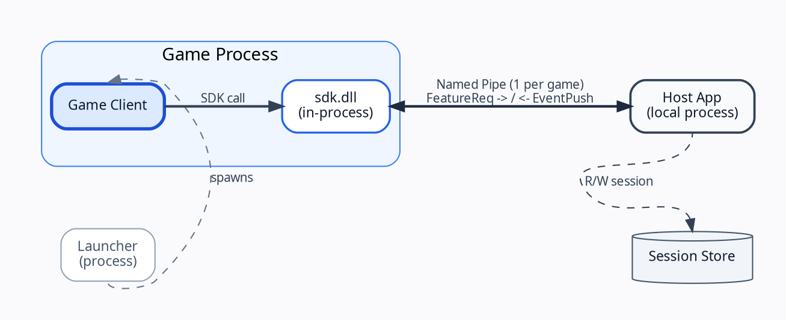
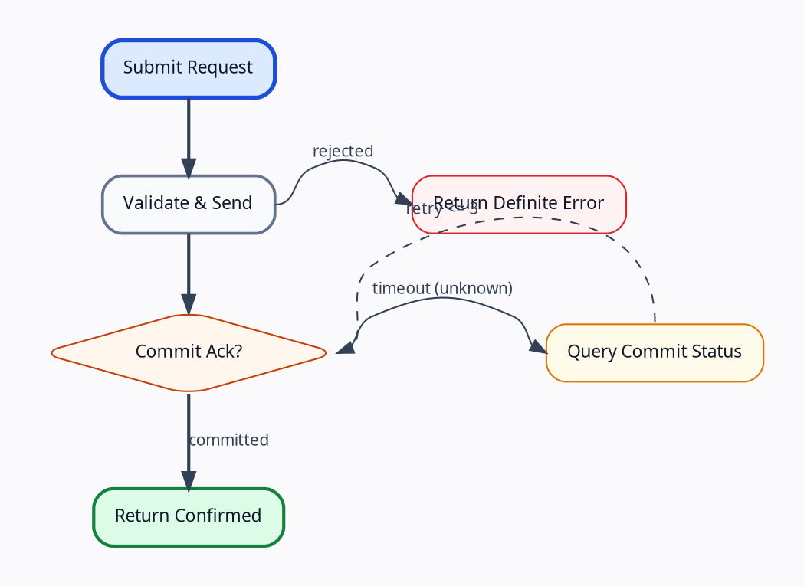

# Explain Architecture

Make the reader immediately see **where to start**, **what the primary actor wants**, and **how the system fulfills that objective**. Choose nodes for their behavioral role, resource identity, or execution step—not source files, classes, or crates, which serve only as evidence links unless the user explicitly asks for a structural map.

This skill governs **display only**. Even in detail mode, never introduce code-review judgments, bug findings, verdicts, or proposed fixes. Inside a broader review task, this skill governs only its diagrams and supporting factual details.

## 1. Establish Story and Evidence

- **Derive prominence from purpose**: Identify the requested behavior, scope, **primary actor (protagonist)**, and **main secondary actor** from the system's goal and the user's question—never from code size, dependency count, or startup chronology.
- **Ground every element in code**: Trace entry points, I/O calls, task creation/dispatch, channels, and shared state. Keep **implemented behavior**, **documented contracts**, **mocks**, and **external/unverified behavior** clearly distinguishable.
- **Never invent machinery**: Do not fabricate network protocols, thread assignments, queue drop policies, rollback, or atomicity to make a diagram look complete. State whether the view reflects **current source**, a **shipped release**, or **observed runtime behavior** whenever they could differ.

## 2. Select Form, Level, and Mode

Diagram **Form**, abstraction **Level**, and detail **Mode** are three orthogonal choices.

### 2.1 Diagram Form & Default Engine

Honor any explicitly requested tool or format (e.g., pure Mermaid, Draw.io, PlantUML, ASCII, schema, or class diagram). Otherwise route by question type:

| Form | Default Engine | When to Use | Node / Lifeline Semantics |
| :--- | :--- | :--- | :--- |
| **Architecture** | **Graphviz DOT** (`rankdir=LR`) | Participants, responsibilities, boundaries, topology | Behavioral roles, processes, channels, storage |
| **Flowchart** | **Graphviz DOT** (`rankdir=TB`) | Execution paths of an API, algorithm, or operation (branches, retries, recovery) | Coherent actions, explicit decisions, outcomes |
| **Sequence** | **Mermaid** (`sequenceDiagram`) | Temporal interaction order, waits, callbacks, responses, handoffs | Logical actors or repeated roles (a lifeline does **not** imply a dedicated OS thread) |

Combine forms only when each explains a distinct aspect. Never infer temporal ordering from a static architecture connection alone.

### 2.2 Abstraction Levels & Scope Routing

- **Default scope routing**: For a broad "explain the architecture" prompt, present **High + Medium** by default and offer **Low** for concurrency-heavy subsystems, rather than dumping every subsystem at all three levels at once. Jump straight to **Medium + Low** (or a single level) when the question targets concurrency, queues, or one operation.
- **Split rather than cram**: Keep each diagram focused (~12–15 nodes max). Split dense levels by interaction or subsystem instead of merging everything into one crowded graph. Preserve naming and state which higher-level actor a zoomed-in diagram expands.

| Level | Core Question | Required Visibility & Grouping Rules |
| :--- | :--- | :--- |
| **High** *(Conceptual)* | Who are the main characters, and what do they accomplish together? | Domain concepts and central objective. One logical actor may span processes or machines. Flowchart nodes represent business stages and key outcomes. Omit low-level machinery unless directly asked. |
| **Medium** *(Observable I/O)* | What crosses a boundary to produce the behavior? | Concrete processes, machines, users, files, and external endpoints. Show every real boundary in scope: network I/O (HTTP/RPC/WS/TCP), DB/cache, IPC, file R/W, UI I/O, DLL/module loading, process spawning. Keep supporting/fallback I/O visible but subordinate. Do **not** hide multiple external calls inside one generic flowchart step. |
| **Low** *(Execution & Sync)* | Where does work run, and how do execution contexts communicate? | Threads, event loops, executors, and worker pools (`subgraph cluster_*`); distinguish blocking workers vs. dedicated threads. Expose task handoffs, waits, connection ownership, channels (producers, consumers, element types), and shared state (readers, writers, locks/atomics) plus verified callback/ordering/backpressure behavior. Retain scoped Medium external endpoints so work traces through to observable I/O. |

### 2.3 Default Mode vs. Detail Mode

Use **Default mode** unless the user explicitly asks for **Detail mode** (`detail mode` / `详细模式`) or its specific additions. **Requesting a Low-level view alone does not enable Detail mode.**

- **Both modes** must show **multiplicity** whenever repeated actors, connections, or tasks exist (e.g., `Worker threads x2`, `Reader tasks x active connections`). Distinguish **fixed counts**, **dynamic counts**, and **configured maximums**—never present a source limit as an observed runtime count.
- **Detail mode adds only**:
  1. **Channel capacities** on the diagram with units or `unbounded` / `unknown` (capacity ≠ current occupancy).
  2. **Boundary data appendix tables** keyed to shown diagram edges (file, IPC, network, ABI), listing only behavior-relevant fields with readable high-level names/meanings and source links to exact definitions. Never dump field inventories onto diagram nodes.

## 3. Non-Negotiable Modeling Laws

1. **Aggregation & P2P Symmetry**: Aggregate repeated actors **only** when their count is incidental/variable **and** their roles and relationships are fully interchangeable. Keep opposite endpoints and distinct ownership contexts separate even when running identical binaries. For one P2P connection, draw the **initiator** and **receiver** and each side's **local client + game/app** separately—never imply a shared local client, connection, or state that does not exist.
2. **In-Process Modules & OS Boundaries**: A DLL, shared library, or in-process plugin runs **inside the process that loads it** (`cluster_*`), regardless of which application distributes its file on disk. Collapse OS services like WMI into ordinary API calls by default unless central/requested, without hiding file, network, or IPC boundaries accessed via OS APIs.
3. **Messages vs. Sessions vs. Connections**: Explicitly state whether interactions multiplex over **one shared connection** or open **separate connections** (even to the same host:port, e.g., `1 WebSocket per room`), and show setup/closure when relevant. In architecture diagrams, draw a **single bidirectional connection as one `dir=both` edge** labeled with transport + messages each way (`Req -> / <- Event`). Split into two edges only to clarify distinct behavior, explicitly noting the shared underlying connection.
4. **Concurrency & State Accuracy**: Never imply one OS thread per coroutine/async task, and never pin a migrating pool task to one fixed worker; mark unverified placement as `unknown`. Draw task-owned local state inside the task—never as cross-thread shared state. Show wait/reject/drop backpressure only when verified in code; never guess from queue names.
5. **Workflow Branch, Retry & Unknown-Commit Rigor**: Give each action node one coherent purpose. Put explicit conditions in diamond nodes and label outgoing branches. Route retry edges back to the **exact step repeated** with the implemented attempt or deadline limit. Distinguish **definite rejection** from an **unknown commit result** (timeout/disconnect after send) and show actual recovery; never invent rollback or atomicity. Mark async dispatch, cleanup, and compensation with their true execution context and trigger conditions (do not imply background tasks finish before the response or that cleanup runs only on success unless proven). Split complex subprocesses while preserving parent stage name, entry, exits, and return position.
6. **Progressive Boundary Data**: Label important edges with real message/type names and purpose. At Medium level, note when wire/file/ABI encoding differs from in-memory structs. Link key actors, producers, consumers, and boundary types to source files.

## 4. Protagonist Composition & Engine Rules

### 4.1 Compose Around the Protagonists

- **Anchor the protagonist first**: Place the primary actor at the natural reading origin (`rank 0`: far-left in `LR`, top in `TB`) with the strongest border weight, followed immediately by the main secondary actor along a straight primary axis. Do **not** rely on `"start here"` text labels to rescue poor layout.
- **Keep upstream helpers subordinate**: Never let a config file, launcher, or DLL loader push the protagonist out of `rank 0` merely because its edge points into the protagonist.
  - *Example*: For a game SDK exposing host features, **Game** is primary and **Host** is secondary along the horizontal request/result spine; DLL loading and launcher relaunch enter perpendicularly as supporting paths. Only a question specifically about launching promotes **Launcher** to protagonist.

### 4.2 Graphviz DOT Mechanics (Architecture & Flowcharts)

Use Graphviz's layout constraints deliberately to eliminate crooked spines and misplaced starts:

- **Straight main spine**: Put `group="main"` on primary-path nodes and `weight=10, penwidth=2.0` on primary-path edges so `dot` locks them onto a single straight axis.
- **Directional port discipline**:
  - In `rankdir=LR`: main spine flows **left-in / right-out** (`A:e -> B:w`); supporting inputs/storage attach **top/bottom** (`:n` / `:s`); loopbacks curve underneath (`:s -> :s`).
  - In `rankdir=TB`: main spine flows **top-in / bottom-out** (`A:s -> B:n`); side exits/branches step **horizontally** (`Decision:e -> Exit:w`); retries loop along the outer side (`:w -> :w` or `:e -> :e`).
- **Prevent rank-0 snap bugs**: In `dot`, any node with **zero incoming constrained edges** snaps to `rank 0`!
  - Use `constraint=false` **only** on backward/retry/callback edges and on rank-0 upstream helpers (`Launcher:s -> Game:n [constraint=false]`).
  - To park a peripheral node (storage, error exit, side helper) directly beside/below an interior node `X` in the **same scope**, lock them with `{ rank=same; X; SideNode }`—**never** write `rank=same` across different `subgraph cluster_*` scopes.
- **Avoid Graphviz parser & routing traps**:
  - **Never use `splines=ortho`**: Graphviz ignores compass ports (`:n/:s/:e/:w`) and misplaces edge `label`s in `ortho` mode. Use `splines=true` or `splines=polyline`.
  - **Container prefix**: Subgraphs draw a visible boundary box **only** when named `subgraph cluster_<id> { ... }`.
  - **Shape & theme semantics**: Always set a light card `bgcolor="#FAFAFC"` and CJK-safe sans-serif `fontname` so SVGs stay readable in both dark and light editors. Use bold rounded boxes for protagonists, standard rounded boxes for roles/actions, `shape=parallelogram` for channels/queues, `shape=cylinder` for storage/shared state, and `shape=diamond` for flowchart decisions. Keep labels short (1–3 lines with `\n`); move bulky payloads to Markdown notes.

**Pattern A — Medium Architecture (`rankdir=LR`, straight spine + in-process DLL + single bidirectional pipe)**:



**Pattern B — Workflow Flowchart (`rankdir=TB`, top-in/bottom-out spine + side exits + bounded retry)**:



### 4.3 Rendering, Output Location & Mermaid Sequence Rules

- **Compile DOT to SVG without dirtying the repo**: Save `.dot` and `.svg` files in the session artifact folder or an OS temp subfolder (never inside an untracked repository tree unless the user asks to save project docs). If `dot` is installed (`dot -Tsvg in.dot -o out.svg`), compile every DOT graph to verify zero syntax errors, link the rendered `.svg` prominently in Markdown, and place the `.dot` source in a collapsible `<details>` block (or inline when brief). If `dot` is unavailable, provide the ```` ```dot ```` block inline and mention installing Graphviz (`scoop install graphviz` / `winget install Graphviz.Graphviz`) in one short note.
- **Mermaid `sequenceDiagram` rules**: Render sequence diagrams inline in ```` ```mermaid ```` blocks. Declare participants in left-to-right interaction order starting with the protagonist. Distinguish sync calls (`->>`), async/queued messages (`-)`), responses (`-->>`), and activation/waits. **Never put raw `;` in sequence messages or notes** (Mermaid parses `;` as a statement break—use `,`, `and`, or `#59;`).
- **No visual-inspection loops**: Checking `dot -Tsvg` exit status validates syntax; do **not** open browsers, capture screenshots, or iterate on rendered pixels.

## 5. Deliver and Verify

1. **Deliver concisely**: State the scope and provenance in 1–2 sentences, present the selected diagrams, explain **only non-obvious consequences and trade-offs** (do not narrate arrows the diagram already shows), link key implementations in source, and disclose any material evidence gaps. Architecture explanation alone requires neither modifying nor running project code.
2. **Pre-finish semantic & syntax check**:
   - DOT compiles cleanly (or passes syntax check) with no `splines=ortho`, no cross-cluster `rank=same`, and no unintended rank-0 orphan nodes; Mermaid sequences contain no raw `;`.
   - Protagonist sits at `rank 0` with bold visual weight; main spine (`group="main"`, `weight=10`) runs straight without detours.
   - Chosen Form, Level, and Mode match the prompt; channels use parallelograms, storage uses cylinders, and single bidirectional transports use one `dir=both` edge with explicit connection multiplicity.
   - DLLs sit inside loader processes; P2P peers remain separate; coroutines are not drawn as OS threads; flowcharts distinguish definite rejection from unknown commit and route retries to the exact repeated step with real limits.
   - Detail-mode capacities and appendix field tables appear **if and only if** requested, with working source links.
